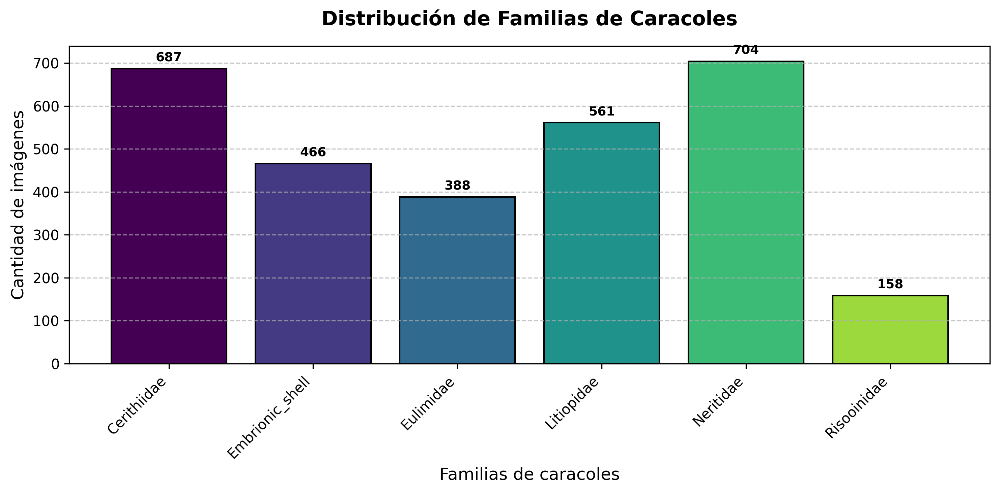

# Clasificación de Familias de Caracoles con Transfer Learning

Clasificación de imágenes de caracoles en **6 familias** usando *transfer learning*
con dos arquitecturas preentrenadas en ImageNet: **VGG16** y **ResNet50**.

Cada arquitectura se entrena dos veces con la misma partición de datos:

- **Sin Data Augmentation**: imágenes originales tal cual.
- **Con Data Augmentation**: rotación (360°), zoom, traslación, contraste y brillo
  aplicados solo durante el entrenamiento.

El objetivo es comparar el efecto de la aumentación de datos en cada arquitectura.

## Dataset

El dataset no está incluido en este repositorio. Se espera un directorio con una
subcarpeta por familia (estructura estándar de `image_dataset_from_directory`):

```
CARACOLES/
├── Cerithiidae/
├── Embrionic_shell/
├── Eulimidae/
├── Litiopidae/
├── Neritidae/
└── Risooinidae/
```

Distribución de clases (2,964 imágenes en total):

| Familia          | Imágenes |
|------------------|----------|
| Cerithiidae      | 687      |
| Embrionic_shell  | 466      |
| Eulimidae        | 388      |
| Litiopidae       | 561      |
| Neritidae        | 704      |
| Risooinidae      | 158      |

Las imágenes se redimensionan a **224×224** y la partición es estratificada
**60% entrenamiento / 20% validación / 20% prueba** (semilla fija `SEED = 42`).
Para compensar el desbalance (Risooinidae es la clase minoritaria) se usan
pesos de clase con `compute_class_weight('balanced')`.

## Estructura del repositorio

```
.
├── caracoles.yml                        # Entorno conda (Python 3.10, TF, scikit-learn, matplotlib)
├── README.md
├── ResNet/
│   ├── keras_transfer_learning_resnet50_caracoles.py
│   └── Resultados/                      # Gráficas y métricas generadas
└── VGG16/
    ├── keras_transfer_learning_vgg16_caracoles.py
    └── Resultados/
```

## Metodología

Ambos scripts siguen el mismo flujo:

1. **Carga y análisis** del dataset (gráfica de distribución por familia).
2. **Partición estratificada** 60/20/20 y cálculo de pesos de clase.
3. **Visualización** de muestras originales vs. aumentadas.
4. **Entrenamiento en dos fases**:
   - *Fase 1*: solo la cabecera nueva (GlobalAveragePooling → Dropout 0.4 →
     Dense softmax) con la base congelada, `Adam(lr=1e-3)`, hasta 15 épocas.
   - *Fase 2*: ajuste fino de los bloques profundos
     (ResNet50: conv4/conv5, con BatchNormalization congelada;
     VGG16: block4/block5), `Adam(lr=5e-6)`, hasta 30 épocas.
   - Callbacks: `EarlyStopping` (restaura los mejores pesos) y
     `ReduceLROnPlateau`.
5. **Evaluación final** sobre el conjunto de prueba (usado una sola vez):
   reporte de clasificación, curvas ROC por clase, matrices de confusión
   (absoluta y normalizada), F1 macro/weighted, AUC macro e intervalo de
   confianza de Wilson al 95% para la exactitud.

## Requisitos

El entorno se puede reproducir con el archivo conda incluido:

```bash
conda env create -f caracoles.yml
conda activate caracoles
```

Dependencias principales: Python 3.10, TensorFlow/Keras 3, scikit-learn,
matplotlib, numpy. (En el entorno original se usó `tensorflow-rocm` para GPU AMD;
en equipos con NVIDIA o CPU basta instalar `tensorflow` estándar con pip.)

## Uso

Edita la variable `folder_path` en cada script para apuntar al directorio del
dataset y ejecuta:

```bash
cd VGG16
python keras_transfer_learning_vgg16_caracoles.py

cd ../ResNet
python keras_transfer_learning_resnet50_caracoles.py
```

Cada corrida genera en el directorio de trabajo:

- `modelo_<arq>_Sin_Data_Augmentation.keras` y `..._Con_Data_Augmentation.keras`
- `clases_*.json` y `metricas_*.json`
- Gráficas PNG: distribución de clases, muestras originales/aumentadas,
  curvas de aprendizaje, curvas ROC y matrices de confusión.

> **Nota:** los archivos `.keras` (modelos entrenados, ~160-270 MB) están
> excluidos del repositorio vía `.gitignore` por el límite de 100 MB de GitHub.

## Resultados

Las gráficas de ambas corridas están en `VGG16/Resultados/` y
`ResNet/Resultados/`. Los scripts imprimen al final una tabla comparativa
(exactitud con IC 95%, F1, AUC y número de errores) de las variantes con y sin
aumentación para cada arquitectura.


